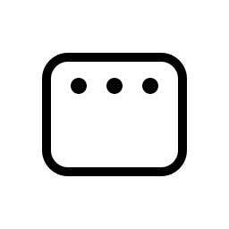

# Refraem

**One menu bar app for Mac** — split-screen layout, screenshots, and (soon) recording.  
Pronounced *Reframe* (ree-FRAME). Native Swift, no Electron.

<p align="center">
  
</p>

<p align="center">
  <a href="https://github.com/yky32/refraem/actions/workflows/build.yml"></a>
  <a href="LICENSE"></a>
  
  
</p>

---

## Why Refraem?

If you use separate tools for **window snapping** and **screen capture**, Refraem combines them into **one menu bar icon** — similar workflow to popular utilities, rebuilt as a single open-source app you can inspect and extend.

| | |
|---|---|
| **Layout** | Halves, thirds, quarters — keyboard shortcuts like Rectangle (^⌥) |
| **Capture** | Full screen & area — ⇧⌘1 / ⇧⌘2 |
| **OCR** | Select region → text on clipboard (^⌥⌘O) |
| **Record** | Coming soon |

## Install

### Recommended — [Releases](https://github.com/yky32/refraem/releases)

1. Download the latest **`Refraem-*-macOS.zip`** from [Releases](https://github.com/yky32/refraem/releases).  
2. Unzip and move **Refraem.app** to **Applications**.  
3. Open **Refraem** from the menu bar (no Dock icon).

> No release yet? Push a tag (`v0.1.0`) or grab the latest zip from [Actions → Artifacts](https://github.com/yky32/refraem/actions) (see [Download from CI](#download-from-ci)).

**First launch:** CI builds are not notarized. Use **Right-click → Open** once if macOS blocks the app.

### Permissions (required)

| Permission | Used for |
|------------|----------|
| **Accessibility** | Move & resize windows (Layout) |
| **Screen Recording** | Capture & OCR |

**System Settings → Privacy & Security** → enable **Refraem**.

## Shortcuts

Refraem must be running (menu bar icon visible).

| Action | Shortcut |
|--------|----------|
| Left / Right / Top / Bottom half | ^⌥ ← → ↑ ↓ |
| Quarters | ^⌥ U I J K |
| Thirds | ^⌥ D F G E T |
| Capture screen | ⇧⌘1 |
| Capture area | ⇧⌘2 |
| Recognize text | ^⌥⌘O |

Captures are copied to the clipboard, saved under **Pictures/Refraem**, and shown in a preview window.

## Roadmap

| Feature | Status |
|---------|--------|
| Layout snap + global hotkeys | ✅ |
| Capture screen / area + OCR | ✅ |
| Scrolling capture | 🔜 |
| Screen record | 🔜 |
| Markup / pin (editor) | 🔜 |
| Notarized release builds | 🔜 |

## Download from CI

For contributors and early testers:

| Trigger | Download |
|---------|----------|
| Push to **`main`** | [Actions](https://github.com/yky32/refraem/actions) → latest **Build** → **Artifacts** |
| Tag **`v*`** | [Releases](https://github.com/yky32/refraem/releases) (best for sharing) |

Maintainers: `git tag v0.1.0 && git push origin v0.1.0`

## Develop

**Requirements:** macOS 14+, Xcode 15+ / Swift 6

```bash
git clone https://github.com/yky32/refraem.git
cd refraem
open Package.swift          # Xcode → Run (⌘R)
# or
swift run Refraem
```

Install locally:

```bash
./scripts/build-app.sh ~/Applications/Refraem.app
```

**Fastlane** (optional, same style as [yky32/lid](https://github.com/yky32/lid)):

```bash
export PATH="/opt/homebrew/opt/ruby/bin:$PATH"
bundle install
bundle exec fastlane mac install
```

See [CONTRIBUTING.md](CONTRIBUTING.md) for PRs and release flow.

## Brand

Logo & B&W marks: [`Sources/Refraem/Resources/Brand/`](Sources/Refraem/Resources/Brand/BRAND.md) · Bundle ID `app.yky.refraem`

## License

[MIT](LICENSE) — use, modify, and ship with attribution.

---

<p align="center">
  <sub>Built by <a href="https://github.com/yky32">yky32</a> · Feedback welcome in <a href="https://github.com/yky32/refraem/issues">Issues</a></sub>
</p>
