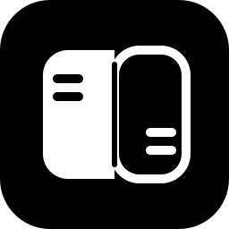

  

<h1 align="center">Refraem</h1>

  <strong>Window layout and screen capture in one menu bar app for Mac.</strong> 
  Native Swift · macOS 14+

  <em>Pronounced</em> <strong>Reframe</strong> <em>(ree-FRAME)</em>

  
  
  
  

  <a href="https://github.com/yky32/refraem/releases"><strong>Download</strong></a>
  ·
  <a href="#install">Install</a>
  ·
  <a href="#shortcuts">Shortcuts</a>

---

## Overview

Refraem replaces a separate window manager and screenshot utility with **one menu bar presence**: snap windows, capture the display, and copy text from the screen—without leaving the menu bar.

| Capability | Details |
|------------|---------|
| **Layout** | Halves, thirds, quarters; global shortcuts (Rectangle-style ^⌥) |
| **Capture** | Full screen, region, and scrolling stitch; ⇧⌘1 / ⇧⌘2 / ⇧⌘3 |
| **OCR** | Region to clipboard as text (^⌥⌘O) |
| **Markup** | Draw on the preview (black pen), then Copy or Pin |
| **Pin** | Float the shot above other windows |
| **Record** | Screen or area to a `.mov` in Pictures/Refraem (^⌥⌘R / ^⌥⌘4). No microphone. |

Open source under the [MIT](LICENSE) license.

## Install

### Releases (recommended)

1. Download **`Refraem-*-macOS.zip`** from [Releases](https://github.com/yky32/refraem/releases).
2. Move **Refraem.app** to **Applications**.
3. Launch from the **menu bar** (no Dock icon).

**Gatekeeper:** Release zips are ad-hoc signed. On first open, use **Right-click → Open** if macOS prompts.

**Trust:** Download only from **[Releases](https://github.com/yky32/refraem/releases)** on **`yky32/refraem`**. See [SECURITY.md](SECURITY.md).

### Permissions

| Permission | Purpose |
|------------|---------|
| Accessibility | Resize and position windows (Layout) |
| Screen Recording | Screenshots and OCR |

Enable **Refraem** under **System Settings → Privacy & Security**.

## Shortcuts

Refraem must be running (menu bar icon visible).

| Action | Shortcut |
|--------|----------|
| Left / right / top / bottom half | ^⌥ ← → ↑ ↓ |
| Quarters | ^⌥ U · I · J · K |
| Thirds | ^⌥ D · F · G · E · T |
| Maximize / almost maximize | ^⌥ ↩ · ^⌥ ⇧↩ |
| Maximize height | ^⌥ ⇧↑ |
| Larger / smaller | ^⌥ = · ^⌥ - |
| Center / restore | ^⌥ C · ^⌥ ⌫ |
| Next / previous display | ^⌥ ⌘→ · ^⌥ ⌘← |
| Capture screen | ⇧⌘1 |
| Capture area | ⇧⌘2 |
| Recognize text (OCR) | ^⌥⌘O |
| Scrolling capture | ⇧⌘3 |
| Record screen (toggle stop) | ^⌥⌘R |
| Record area | ^⌥⌘4 |

Captures go to the **clipboard**, **Pictures/Refraem**, and an optional preview window.

## Roadmap

| Feature | Status |
|---------|--------|
| Layout snap and global hotkeys | ✅ |
| Screen / area / scrolling capture and OCR | ✅ |
| Markup (black pen) and pin | ✅ |
| Screen recording (no mic) | ✅ |
| Notarized release builds | 🔜 needs Apple secrets |

## Download from CI

| Event | Where |
|-------|--------|
| Push to `main` | [Actions](https://github.com/yky32/refraem/actions) → **Build** → **Artifacts** (zip, ad-hoc) |
| Tag `v*` | [Releases](https://github.com/yky32/refraem/releases) → **Refraem-*-macOS.zip** |

## Brand

Marks and usage: [`Sources/Refraem/Resources/Brand/BRAND.md`](Sources/Refraem/Resources/Brand/BRAND.md)

## License

[MIT](LICENSE)

---

  <a href="https://github.com/yky32/refraem/issues">Issues & feedback</a>
  ·
  <a href="https://github.com/yky32">yky32</a>

